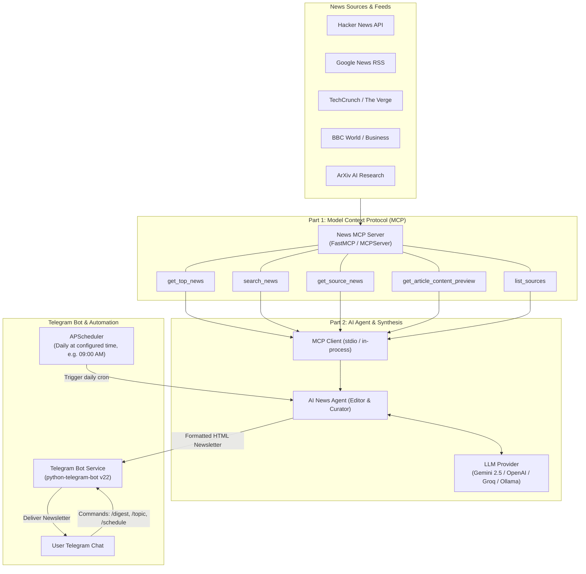

# 📰 AI News Agent & Telegram Newsletter (MCP Mini-Project)

An end-to-end LLM mini-project featuring a **Model Context Protocol (MCP) Server** for live multi-source news aggregation and an **AI Agent with Telegram Automation** that synthesizes and delivers a daily morning newsletter digest directly to your Telegram chat.

---

## 🌟 System Architecture



---

## 🚀 Key Features

### 1. Part 1: News MCP Server (`mcp_server/`)
- **Model Context Protocol (MCP 2.x/1.x) standard**: Exposes tools callable by any MCP client (Claude Desktop, Cursor, or custom Python agents).
- **Multi-Source Aggregation**:
  - **Hacker News**: Live Firebase API for top tech and developer discussions.
  - **Google News RSS**: Real-time topic search and category-specific feeds (Tech, AI, Business, World, Science).
  - **Tech Publications**: TechCrunch, The Verge, Wired RSS.
  - **Global Press**: BBC News (World, Business, Science).
  - **Academic AI**: ArXiv AI research papers.
- **MCP Tools**:
  - `get_top_news(category, limit)`: Aggregates top stories for a category.
  - `search_news(query, limit)`: Live keyword search across all feeds.
  - `get_source_news(source, limit)`: Publisher-specific news queries.
  - `get_article_content_preview(url)`: Extracts visible text for in-depth analysis.
  - `list_sources()`: Returns supported sources and categories.
- **Resilient Fallback**: Gracefully provides sample curated news when running in restricted or offline sandbox environments.

### 2. Part 2: AI Agent & Telegram Automation (`agent/` & `telegram_bot/`)
- **Editorial Intelligence**:
  - Synthesizes raw feeds into an authentic, executive-grade newsletter:
    - 📰 **Header**: Date & edition name.
    - ⚡ **The Big Picture (TL;DR)**: 3-4 bullet executive takeaways.
    - 🔥 **Top Stories & Analysis**: Categorized news with "Why it Matters" context and read-more links.
    - 💡 **Tech & AI Pulse**: Latest breakthroughs.
    - 📌 **Quick Bites**: 3-5 punchy updates.
    - ☕ **Parting Thought**: Thought of the day.
- **Multi-LLM Support**:
  - Google Gemini (`gemini-2.5-flash`, `gemini-1.5-pro` via new `google-genai` SDK)
  - OpenAI (`gpt-4o-mini`, `gpt-4o`)
  - Groq (`llama-3.3-70b-versatile` for fast free inference)
  - Local Ollama (`llama3.2`, etc.)
  - High-fidelity fallback synthesizer (works immediately even without an API key for quick demos!).
- **Automated Telegram Delivery**:
  - Powered by `APScheduler` cron scheduler.
  - Delivers your newsletter automatically every morning at your desired time (e.g. `09:00 AM`).
  - Interactive commands to view or adjust delivery time dynamically (`/schedule 08:30`).

---

## 📁 Repository Structure

```
.
├── mcp_server/
│   ├── __init__.py
│   ├── server.py              # MCPServer exposing tools (stdio & programmatic)
│   ├── sources.py             # Multi-source RSS & API aggregators
│   └── models.py              # Pydantic data schemas
├── agent/
│   ├── __init__.py
│   ├── news_agent.py          # AI News Agent orchestration & newsletter compiler
│   ├── mcp_client.py          # MCP Client (stdio JSON-RPC & direct mode)
│   ├── prompts.py             # Editorial system prompts
│   └── llm.py                 # Multi-provider LLM interface (Gemini, Groq, OpenAI, Ollama)
├── telegram_bot/
│   ├── __init__.py
│   ├── bot.py                 # Telegram Bot command handlers & subscriber manager
│   └── scheduler.py           # APScheduler automation for daily delivery
├── tests/
│   ├── test_mcp_server.py     # Unit tests for MCP server tools
│   └── test_agent.py          # Unit tests for Agent & Scheduler
├── .env.example               # Environment variables configuration template
├── pyproject.toml / requirements.txt
├── run_mcp_server.py          # Standalone launcher for MCP Server (Claude/Cursor)
├── run_bot.py                 # Main entrypoint: Bot + Scheduler + Test CLI
└── README.md
```

---

## 🛠️ Quickstart Guide

### 1. Prerequisites
- Python 3.10+
- A Telegram account

### 2. Setup Virtual Environment & Install Dependencies
```bash
# Create and activate virtual environment
python3 -m venv .venv
source .venv/bin/activate

# Install dependencies
pip install -r requirements.txt
```

### 3. Configure Environment Variables
Copy `.env.example` to `.env`:
```bash
cp .env.example .env
```
Edit `.env` with your preferred settings:
```ini
# Telegram Bot Token (from @BotFather on Telegram)
TELEGRAM_BOT_TOKEN="123456789:ABCdefGhIJKlmNoPQRsTUVwxyZ"

# Your personal chat ID (from @userinfobot or @raw_data_bot on Telegram)
TELEGRAM_CHAT_ID="987654321"

# Daily Scheduled Delivery Time (24-hr HH:MM)
DAILY_DIGEST_TIME="09:00"
TIMEZONE="Asia/Kolkata"

# LLM Provider (gemini, groq, openai, ollama, or auto)
LLM_PROVIDER="auto"
GEMINI_API_KEY="your-gemini-api-key"
# or GROQ_API_KEY="your-groq-key"
# or OPENAI_API_KEY="your-openai-key"
```

---

## 🧪 Testing the Pipeline Locally (No Telegram Token Needed)

You can test the entire MCP Server + AI Agent synthesis pipeline locally in your terminal before launching the Telegram bot:

```bash
# Generate general daily newsletter
python run_bot.py --test-digest

# Generate tech or AI category newsletter
python run_bot.py --test-digest --category tech

# Generate custom topic newsletter
python run_bot.py --topic "Artificial Intelligence Agents"
```

---

## 🤖 Running the Telegram Bot with Daily Automation

Start the live Telegram bot and daily cron scheduler:
```bash
python run_bot.py
```

### Available Telegram Commands:
| Command | Description |
|---|---|
| `/start` | Subscribe to the bot and receive daily automated briefings |
| `/digest [category]` | Generate and receive the newsletter immediately (`all`, `tech`, `ai`, `business`, `world`) |
| `/topic <keyword>` | Generate an on-demand deep-dive briefing on any topic (e.g. `/topic Quantum Computing`) |
| `/schedule [HH:MM]` | View current delivery time or update it dynamically (e.g. `/schedule 08:30`) |
| `/sources` | List all active news feeds and categories in the MCP server |
| `/status` | View AI Agent model, MCP client mode, subscriber count, and scheduler status |
| `/unsubscribe` | Stop daily automated deliveries |
| `/help` | Detailed command manual |

---

## 🔌 Using the MCP Server in Claude Desktop or Cursor

You can also connect the News MCP Server directly to **Claude Desktop** or **Cursor IDE**:

Add this to your `claude_desktop_config.json`:
```json
{
  "mcpServers": {
    "news-aggregator": {
      "command": "/absolute/path/to/news-mcp-telegram-agent/.venv/bin/python",
      "args": ["/absolute/path/to/news-mcp-telegram-agent/run_mcp_server.py"]
    }
  }
}
```

Now Claude or Cursor can autonomously call `get_top_news`, `search_news`, and `get_source_news`!

---

## 🧪 Running Unit Tests

Run the test suite to verify the MCP server and Agent logic:
```bash
python -m unittest tests/test_mcp_server.py tests/test_agent.py
```
Or directly:
```bash
python tests/test_mcp_server.py
python tests/test_agent.py
```

---

## 📜 License
MIT License. Built as an LLM mini-project demonstration.
